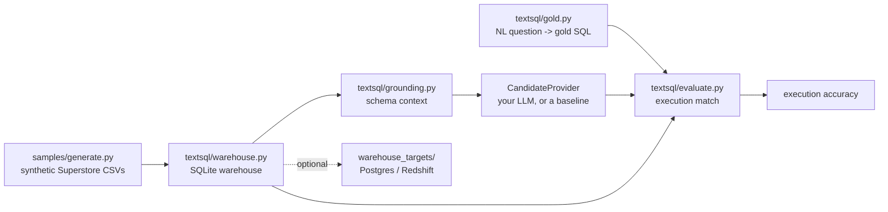

# grounded-text-to-sql-lab

A small, offline harness that stands up a real analytical SQL warehouse, builds the schema-grounding context a model needs, and scores text-to-SQL output by execution match against a gold question set.

## Why

Most text-to-SQL demos score models by comparing SQL strings, which is misleading: many different queries return the same answer, and a model can be marked wrong for a correct query or right for a lucky guess. The metric that matters is whether the generated SQL returns the right rows when it actually runs. That requires a real database to run against and a gold set whose answers are defined by execution, not by string shape. This lab provides both, with no credentials and no network, so results are reproducible on any machine.

## Architecture



- `samples/generate.py` writes a synthetic `orders / returns / people` dataset (no real data).
- `textsql/warehouse.py` loads those CSVs into an in-memory SQLite database.
- `textsql/grounding.py` introspects the live schema and emits a compact, prompt-ready description with example values.
- A `CandidateProvider` turns a question plus that schema context into SQL. This is where a real LLM plugs in; two offline providers ship for testing.
- `textsql/evaluate.py` runs candidate and gold SQL against the warehouse and compares result sets.
- `warehouse_targets/` optionally mirrors the same schema into Postgres, Aurora, or Redshift.

## Key decisions and trade-offs

- **Execution match, not string match.** Correctness is defined as result-set equality against the gold query. Row order is only enforced when the gold SQL has an `ORDER BY`. This rewards any query that returns the right data and avoids penalising stylistic differences, at the cost of occasionally accepting a query that is right on this data but wrong in general.
- **SQLite as the default warehouse.** The lab runs with zero credentials and no network so the numbers are reproducible anywhere. The same schema can be published to a managed warehouse via `warehouse_targets/` when you want to exercise a real engine.
- **Synthetic data, generated not committed.** No third-party or private dataset is shipped. `generate.py` is deterministic (seeded), so a given seed always produces the same gold answers.
- **The model is a pluggable seam, not a dependency.** No API key is required to run the harness. `GoldReplayProvider` is a self-test that must score 100% (if it does not, the evaluator is broken); `KeywordHeuristicProvider` is a deliberately naive baseline that scores partially, which demonstrates the metric discriminates.
- **Short-lived credentials for the cloud targets.** The optional Postgres/Aurora path uses IAM auth tokens (see `warehouse_targets/iam_token.sh`) rather than a stored database password, so nothing long-lived sits in the environment.

## Evaluation

`textsql/evaluate.py` reports execution accuracy over the gold set in `textsql/gold.py` (13 questions spanning aggregates, group-by, ranking, date filters, lookups, and a join). Example, naive baseline:

```
$ python run_eval.py --provider keyword
Provider: keyword
...
Execution accuracy: 5/13 = 38.5%

$ python run_eval.py --provider gold
Execution accuracy: 13/13 = 100.0%
```

The gold provider's perfect score is the harness self-test; the keyword baseline's partial score shows the metric separates right from wrong.

## Run locally

```bash
python3 samples/generate.py --out data     # synthesise the dataset
python3 run_eval.py --provider gold        # self-test, expect 100%
python3 run_eval.py --provider keyword     # naive baseline, partial score
python3 -m unittest discover -s tests -v   # tests
```

No dependencies are needed for the core lab (standard library only). To use the optional cloud targets, `pip install psycopg2-binary boto3` and copy `.env.example` to `.env`.

## Evaluate a real model

A provider for any OpenAI-compatible chat API ships in `textsql/providers/openai_compatible.py`. It is configured only through the environment, so no key is stored in the repo. Copy `.env.example` to `.env` and set `OPENAI_API_KEY` (and `OPENAI_BASE_URL` for a non-OpenAI endpoint).

```bash
python3 run_eval.py --provider llm --model gpt-4o-mini
python3 run_eval.py --provider llm --model model-a --model model-b   # compare, writes results/latest.md
```

Run it with your own key; results depend on the model, so no score is published here. The comparison writes a Markdown table to `results/latest.md`. Without a key the command prints a clear message and exits without a traceback.

To wire in a different backend, implement a `CandidateProvider` (a callable taking the question and `grounding.schema_context(conn)`, returning SQL) and pass it to `evaluate(conn, provider)`.

## Limitations and next steps

- The gold set is small and single-table-leaning; it covers common analytical patterns but is not a stress test of complex joins or window functions.
- Execution match can accept a query that is correct on this dataset but not in general. Adding multiple data variants per question (perturbing the warehouse) would catch more of those.
- The bundled provider targets OpenAI-compatible chat APIs; other backends need a small adapter implementing the same `CandidateProvider` call.
- Next steps worth doing: an optional schema-linking step before generation, result canonicalisation for float rounding, and a difficulty breakdown by question tag.
